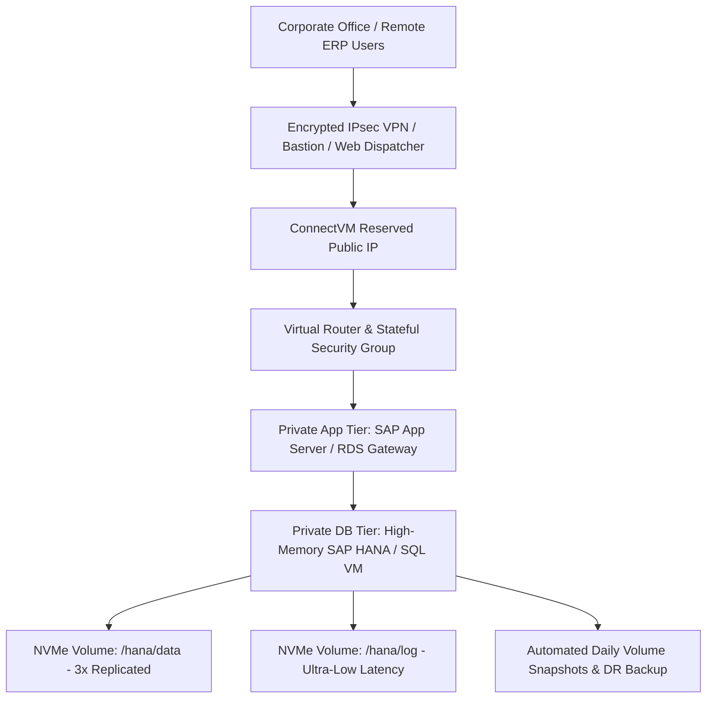

# SAP Cloud Solutions — ConnectVM.com

## SEO Metadata
- **Meta Title:** SAP Cloud Hosting | SAP Business One, HANA & S/4HANA Infrastructure | ConnectVM
- **Meta Description:** Run mission-critical SAP workloads on ConnectVM. High-memory virtual machines, ultra-low-latency NVMe block storage, isolated VPC security, and automated disaster recovery for SAP.
- **Primary Keywords:** SAP cloud hosting, SAP Business One cloud, SAP HANA cloud infrastructure, SAP S/4HANA hosting, enterprise ERP cloud, high memory VM for SAP
- **URL Slug:** `/products/sap`

---

## 1. Hero Section

**Eyebrow:** CONNECTVM FOR SAP
**H1:** Enterprise-Grade Cloud Infrastructure Purpose-Built for SAP Workloads.
**Subheadline:** Migrate and run SAP Business One, SAP HANA, and SAP NetWeaver/S/4HANA landscapes with confidence. ConnectVM combines high-memory compute instances, sub-millisecond triple-replicated NVMe storage, and isolated private networking—delivering rock-solid ERP performance at a fraction of hyperscaler costs.

**Primary CTA:** Talk to an SAP Cloud Architect →
**Secondary CTA:** Request Custom SAP Sizing

---

## 2. Why Run SAP on ConnectVM?

**Eyebrow:** BUILT FOR MISSION-CRITICAL ERP
**H2:** Eliminate Hardware Refresh Cycles and Hyperscaler Complexity

Running SAP on-premises locks capital into aging hardware, while running SAP on legacy hyperscalers often results in runaway egress fees, complex licensing tiers, and unpredictable support bills. ConnectVM delivers a clean, high-performance infrastructure layer tailored for SAP partners and enterprise IT teams:

1. **High-Memory, High-Frequency Compute:** SAP HANA and in-memory ERP databases demand massive memory bandwidth and high single-thread CPU clock speeds. Our Memory-Optimized instances deliver dedicated ECC RAM and enterprise processors without noisy-neighbor degradation.
2. **Ultra-Low-Latency NVMe Storage:** Database commits and log writes happen on triple-replicated NVMe block storage, ensuring rapid transaction processing and zero data loss if a physical drive fails.
3. **Complete Network Isolation (VPC):** Keep your SAP database and application servers completely hidden from the public internet inside a private Layer-2/Layer-3 network, accessible only via encrypted Site-to-Site IPsec VPN, WireGuard, or hardened RDP/Citrix/Web Dispatcher gateways.

---

## 3. Supported SAP Landscapes & Solutions

### 1. SAP Business One (SQL Server & SAP HANA Editions)
Turnkey cloud infrastructure for small-to-midsize enterprises and SAP B1 partners.
- Run SAP B1 Server, License Manager, Service Layer, and Windows Terminal Server / RDS instances inside a unified private subnet.
- Scale user capacity seamlessly as your organization adds branches or remote workers.

### 2. SAP HANA & S/4HANA Landscapes (Dev, QA, & Production)
High-memory Linux instances (SUSE Linux Enterprise Server / Red Hat Enterprise Linux compatible) with separated `/hana/data`, `/hana/log`, and `/hana/shared` high-IOPS NVMe volumes.
- Clone multi-terabyte Production SAP landscapes into isolated QA/Sandbox environments in minutes using **Instant Volume Snapshots**.

### 3. High-Availability (HA) & Disaster Recovery (DR) for SAP
Protect your business against downtime:
- **Anti-Affinity Host Placement:** Guarantee primary and standby SAP HANA / SQL nodes run on physically separate hypervisors.
- **Virtual IP (VIP) Failover:** Native support for Pacemaker/Corosync and VRRP floating Virtual IPs for automated sub-second cluster failover.
- **Automated Snapshot & Off-Instance Backups:** Point-in-time recovery for both OS root volumes and database volumes.

---

## 4. Reference Architecture: SAP on ConnectVM

---

## 5. Top SAP Cloud Use Cases

- **On-Premises SAP Migration (Lift & Shift):** Retire aging local servers and move existing SAP VMs or custom images directly to ConnectVM with identical private IP addressing.
- **Rapid SAP Sandbox & Upgrade Testing:** Spin up temporary clones of your production ERP before applying support packages or version upgrades, and destroy the clone when testing concludes.
- **Managed Service Provider (MSP) & SAP Partner Hosting:** Host multi-tenant or dedicated customer SAP Business One environments in isolated project spaces with predictable monthly margins.

---

## 6. Call-to-Action

**H2:** Plan Your SAP Cloud Deployment with Our Engineering Team
**Subheadline:** Get a customized sizing assessment, network topology design, and transparent TCO comparison for your SAP landscape.
**Primary CTA:** Request an SAP Architecture Consultation →
