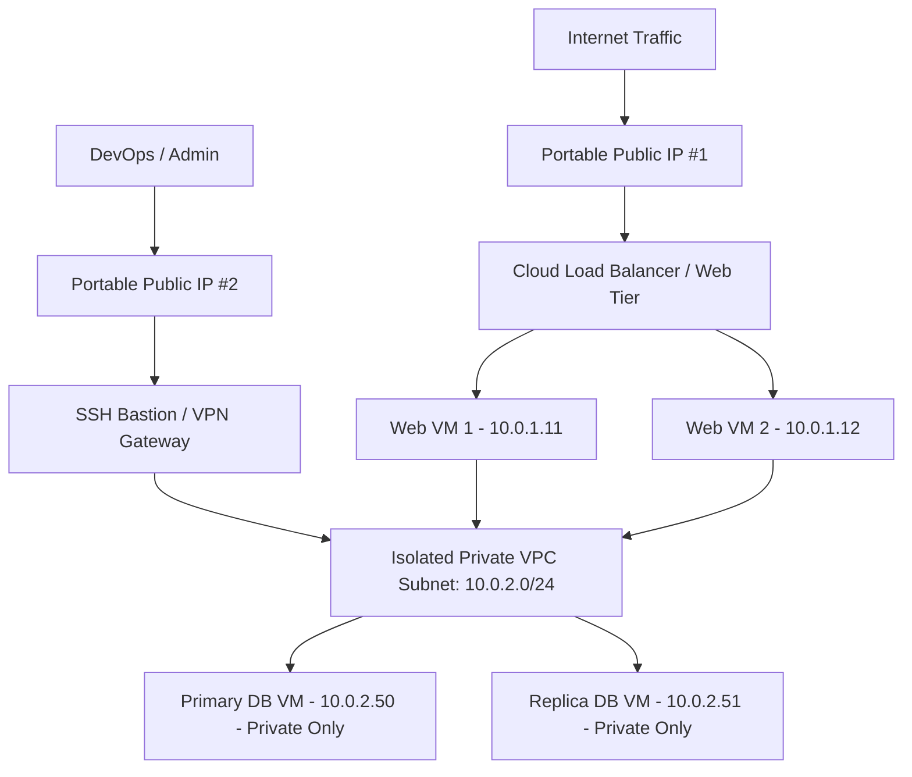

# Networking & Public IP — VPC, Floating IPs & Load Balancers — ConnectVM.com

## SEO Metadata
- **Meta Title:** Cloud Networking | Portable Public IPs, Isolated VPC & Load Balancers | ConnectVM
- **Meta Description:** Architect resilient cloud networks on ConnectVM. Reserve portable Public IPs with instant failover, build isolated Virtual Private Clouds (VPC), and deploy Cloud Load Balancers.
- **Primary Keywords:** cloud public IP, portable public IP, floating IP cloud, virtual private cloud VPC, cloud load balancer, virtual router SNAT
- **URL Slug:** `/products/networking`

---

## 1. Hero Section

**Eyebrow:** CONNECTVM NETWORKING
**H1:** Software-Defined Cloud Networking & Portable Public IPs.
**Subheadline:** Take full control of your network topology. Reserve static Public IPs that move across your VMs in seconds, isolate backend workloads in custom Virtual Private Clouds (VPC), and scale traffic effortlessly with managed Load Balancers and Virtual Routers.

**Primary CTA:** Configure Your Cloud Network →
**Secondary CTA:** Explore Public IP Features

---

## 2. Spotlight Feature: ConnectVM Portable Public IPs

**Eyebrow:** ZERO-DOWNTIME IP MOBILITY
**H2:** Static Public IPv4 Addresses Decoupled From Your Servers

In legacy hosting, an IP address is hardwired to a single virtual machine—if that server fails or needs to be replaced, your IP changes and your users face DNS propagation outages.

On **ConnectVM**, **Public IPs** (Elastic / Floating IPs) are independent network resources reserved directly to your account pool. Our edge virtual routers map your Public IP to your instance's Private IP via high-speed 1:1 Stateless NAT.

### What You Can Do With ConnectVM Public IPs:
- **Keep Your IP Forever:** Stop, rebuild, resize, or even delete a VM—your reserved Public IP stays safely in your account pool until you release it.
- **Instant Failover & Reassignment:** Remap a live Public IP from a primary VM to a standby VM in under 2 seconds via the web console or REST API—zero DNS changes required.
- **Blue-Green Production Cutovers:** Test a new release on a staging VM, then swap the production Public IP over to the new VM for an instant, reversible deployment.
- **Partner Firewall Whitelisting:** Maintain permanent, unchanging IPv4 addresses for enterprise client connections, banking APIs, and third-party whitelists.

---

## 3. Complete Cloud Networking Suite

### 1. Isolated Virtual Private Cloud (VPC) & Custom Subnets
Every ConnectVM project gets its own completely isolated Layer-2/Layer-3 network fabric.
- Define custom RFC1918 private CIDR ranges (e.g., `10.10.0.0/24`, `192.168.1.0/24`).
- Create separate subnets for Web, Application, and Database tiers.
- Configure custom DHCP pools, static internal routes, and DNS resolvers.
- **Free East-West Traffic:** High-speed internal traffic between VMs inside your private network is completely isolated and free of bandwidth charges.

### 2. Managed Virtual Routers & Outbound SNAT
Connect private subnets cleanly and securely:
- **Multi-Subnet Routing:** Route traffic between multiple internal private networks.
- **Outbound Source NAT (SNAT):** Allow private-only VMs (such as database servers or worker nodes with no Public IP) to securely reach the internet to download OS security updates while remaining 100% unreachable from outside.

### 3. Cloud Load Balancers
Distribute incoming traffic across multiple Virtual Machines for horizontal scale and high availability:
- **Layer-4 & Layer-7 Load Balancing:** Support for TCP, UDP, HTTP, and HTTPS traffic distribution.
- **Automated Health Checks:** Continuously monitor backend VMs and automatically remove unhealthy nodes from rotation.
- **Flexible Algorithms:** Round-robin, least-connections, and source-IP session persistence.

### 4. Virtual IP (VIP) & Allowed Address Pairs
Running your own HAProxy, NGINX, or Keepalived/VRRP high-availability cluster? Configure **Allowed Address Pairs** on your virtual network interfaces so multiple VMs can share floating internal or external Virtual IPs for sub-second heartbeat failover.

### 5. Multi-NIC Virtual Machines
Attach multiple virtual network interfaces (vNICs) to any VM to physically and logically segregate public ingress traffic, private database cluster replication, and storage/backup traffic.

### 6. Hybrid Cloud & Site-to-Site VPN Ready
Extend your on-premises data center or corporate office into ConnectVM using IPsec Site-to-Site VPNs, OpenVPN, or WireGuard gateways.

---

## 4. Networking Reference Architecture

---

## 5. Networking Use Cases

| Scenario | ConnectVM Networking Solution |
| :--- | :--- |
| **Zero-Downtime Maintenance** | Detach the **Public IP** from `Web-Server-01` and attach it to `Web-Server-02` while patching OS kernels. |
| **Zero-Exposure Databases** | Place PostgreSQL/MongoDB on a **Private VPC Subnet** with no Public IP; use the **Virtual Router SNAT** for outbound package updates. |
| **High-Traffic Flash Sales** | Attach a **Public IP** to a **Cloud Load Balancer** and scale backend Web VMs horizontally across anti-affinity hosts. |
| **Hybrid Cloud Extension** | Connect your office firewall to a ConnectVM VPN Gateway to access internal ERP and database VMs over private IPs. |

---

## 6. Frequently Asked Questions

**Q: Do I have to pay for a Public IP on every VM?**
A: No. Only internet-facing VMs or Load Balancers need a Public IP. You can run dozens of internal application, cache, and database VMs using only free Private VPC IPs.

**Q: Does reassigning a Public IP require rebooting my VM?**
A: Never. Public IP reassignment happens instantaneously at the ConnectVM Virtual Router layer using 1:1 NAT. Your VM's internal operating system doesn't even need to restart its network service.

---

## 7. Call-to-Action

**H2:** Design Your Isolated Cloud Network in Minutes
**Subheadline:** Combine portable Public IPs, private VPC subnets, and stateful security groups on ConnectVM.
**Primary CTA:** Launch Your VPC Network →
