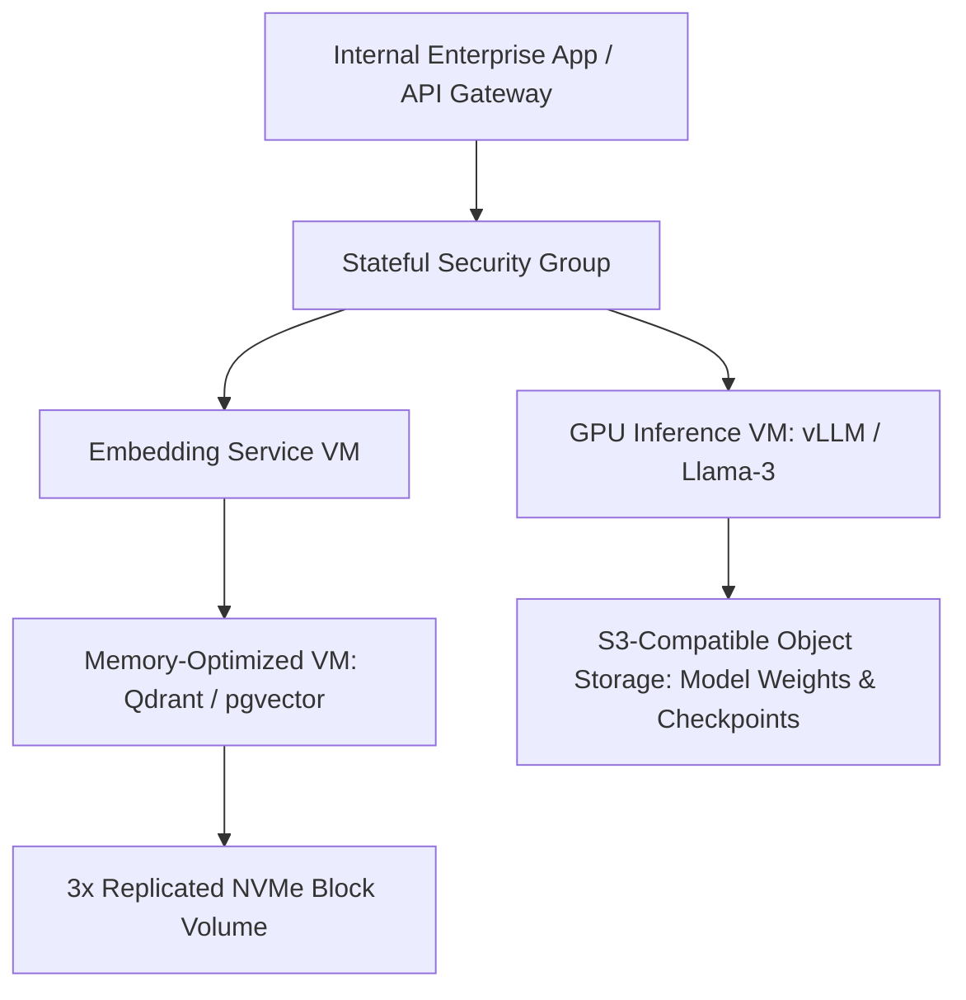

# AI & Machine Learning — Cloud GPUs & Private LLM Hosting — ConnectVM.com

## SEO Metadata
- **Meta Title:** AI & ML Cloud | Cloud GPU Instances & Private LLM Hosting | ConnectVM
- **Meta Description:** Train, fine-tune, and deploy AI models on ConnectVM. Dedicated GPU cloud instances, private LLM inference inside isolated VPCs, and high-memory Vector Database hosting.
- **Primary Keywords:** AI cloud infrastructure, cloud GPU instances, private LLM hosting, machine learning cloud servers, vector database hosting, RAG cloud architecture
- **URL Slug:** `/products/ai-ml`

---

## 1. Hero Section

**Eyebrow:** CONNECTVM AI & MACHINE LEARNING
**H1:** Dedicated Cloud GPUs & Private AI Infrastructure—Inside Your Own VPC.
**Subheadline:** Build, fine-tune, and serve AI models without sending proprietary enterprise data to third-party public APIs. ConnectVM pairs GPU-accelerated instances with high-throughput NVMe storage and isolated private networking for complete AI sovereignty.

**Primary CTA:** Launch AI & GPU Compute →
**Secondary CTA:** Request GPU Cluster Quota

---

## 2. Core AI & ML Infrastructure Capabilities

**Eyebrow:** PRIVATE AI AT SCALE
**H2:** Purpose-Built Infrastructure for the Modern AI Stack

### 1. Dedicated GPU Cloud Instances (PCIe Passthrough)
Access raw, unshared GPU acceleration directly inside your Virtual Machine via hardware PCIe passthrough—delivering near-bare-metal CUDA and tensor performance for training, fine-tuning, and low-latency inference.

### 2. 100% Private LLM Hosting & Inference
Concerned about data privacy, compliance, or unpredictable per-token API bills?
- Host open-weights models (**Llama 3, Mistral, DeepSeek, Qwen, Whisper, Stable Diffusion**) on your own ConnectVM instances using vLLM, Ollama, TGI, or NVIDIA Triton.
- Keep all prompts, embeddings, and customer data strictly inside your isolated **ConnectVM Private VPC**.

### 3. High-Memory Vector Database Infrastructure (RAG)
Retrieval-Augmented Generation (RAG) requires fast memory access and ultra-low disk latency:
- Run **Qdrant, Milvus, Weaviate, Chroma, or PostgreSQL (`pgvector`)** on ConnectVM **Memory-Optimized VMs** backed by triple-replicated NVMe block storage for millisecond similarity search over tens of millions of embeddings.

### 4. High-Throughput Storage for Training Datasets
- Store multi-terabyte raw training datasets, model checkpoints, and LoRA adapters on **S3-Compatible Object Storage** or **Shared File Storage**.
- Stream training batches into GPU instances over high-speed internal networks without egress fees.

### 5. Pre-Configured AI/ML Images & Cloud-Init Automation
Skip hours of driver headaches. Boot instances with pre-validated Ubuntu AI templates featuring CUDA, cuDNN, Docker, NVIDIA Container Toolkit, PyTorch, and JupyterLab ready out of the box.

---

## 3. AI & ML Use Cases on ConnectVM

| AI Workload | ConnectVM Architecture | Business Advantage |
| :--- | :--- | :--- |
| **Private Enterprise Chatbots & Copilots** | GPU Inference VM + Vector DB VM inside an isolated Private VPC | Zero data leakage to external AI vendors; flat, predictable monthly cost |
| **Model Fine-Tuning (LoRA / QLoRA)** | On-demand GPU VMs + High-IOPS NVMe Volume + Object Storage checkpoints | Spin up GPU compute only during training runs; keep checkpoints on persistent storage |
| **Computer Vision & Video Analytics** | GPU Instances + High-bandwidth ingress via Portable Public IP | Real-time object detection, OCR, and media transcoding |
| **Automated MLOps Pipelines** | API-driven ephemeral VMs for data preprocessing + model evaluation | Automate end-to-end training workflows via ConnectVM REST API |

---

## 4. Reference Architecture: Private Enterprise RAG & LLM Pipeline

---

## 5. Call-to-Action

**H2:** Take Full Ownership of Your AI Models and Data
**Subheadline:** Deploy private LLMs, vector databases, and GPU workloads on ConnectVM today.
**Primary CTA:** Deploy AI Infrastructure →
**Secondary CTA:** Speak With an AI Infrastructure Specialist
